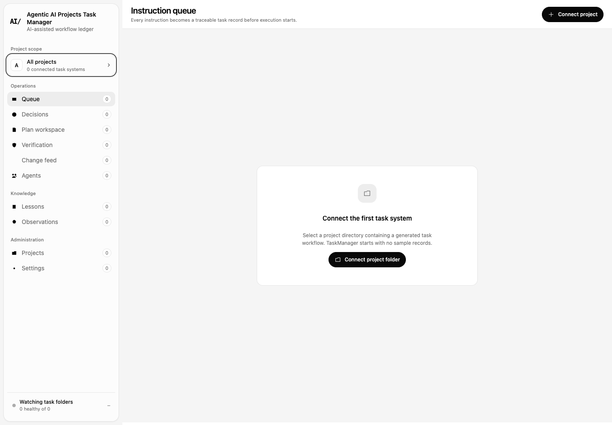
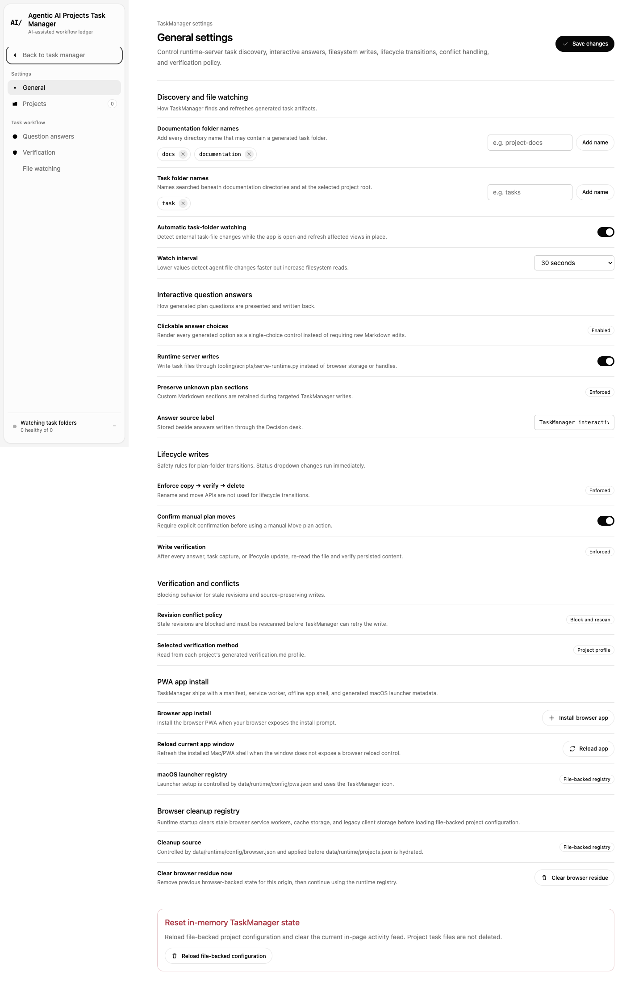

# Agentic AI Projects Task Manager

An open-source, local-first workspace for planning, coordinating, and verifying AI-assisted software tasks.

It turns Markdown task plans into a focused operational interface for queues, decisions, lifecycle transitions, agent activity, project registries, lessons, observations, and user verification. Your task data stays in project folders you choose; the application has no hosted account requirement and no built-in telemetry.

## What it does

- Aggregates task-system folders from multiple local projects.
- Presents queue, plan-detail, question, verification, activity, agent, lesson, observation, project, and settings views.
- Writes lifecycle changes and user-verification feedback back to the project’s Markdown/JSON task records.
- Runs as a PWA, a local writable web app, or an unsigned Electron desktop build.
- Uses isolated public app data under `Agentic AI Projects Task Manager`; it does not import another product’s registry automatically.
- Works with any coding agent or human workflow that follows the documented task-folder contract.

This project may feel familiar to people who use Notion to organize work, but its scope is narrower: it is a filesystem-backed software-task workspace, not a collaborative document/database suite. It is not affiliated with, endorsed by, or feature-compatible with Notion Labs, Inc., and it does not claim Notion feature parity.

## Screenshots





## Quick start

Requirements: Node.js 20 or newer, npm, and Python 3.11 or newer.

```bash
npm ci
npm test
./start-app.sh
```

Open `http://127.0.0.1:8765/`. Use **Projects** to connect a folder that contains the task-system structure described in [`docs/tasks/workflow.md`](docs/tasks/workflow.md).

For the desktop app on macOS:

```bash
npm run electron:pack
open "build/release/mac-arm64/Agentic AI Projects Task Manager.app"
```

The packaged app is unsigned. Signing and notarization are intentionally outside this repository’s default build.

## Development

```bash
npm run build:web      # rebuild dist/ and DEPLOY_MANIFEST.json
npm test               # unit, contract, static, source/dist browser and filesystem checks
npm run electron:dev   # build the web app and open Electron
```

Production source lives only in `src/taskmanager/`. `dist/` and `DEPLOY_MANIFEST.json` are generated. The production boundary requires zero mockup data and zero dummy data. Reference, test, operational, and private runtime material must not be deployed.

## Architecture and privacy

- `src/taskmanager/js/domain/` parses and writes task Markdown.
- `src/taskmanager/js/features/` owns route-level Task Manager views.
- `src/taskmanager/js/services/` connects UI actions to the local runtime.
- `tooling/scripts/serve-runtime.py` and `electron/runtime-server.cjs` provide matching confined filesystem endpoints.
- `docs/tasks/` defines the reusable lifecycle, schema, planning, review, and verification contracts.

The default desktop/runtime registry begins as `{ "version": 1, "projects": [] }` in the product’s own Application Support directory. No legacy registry is read, merged, copied, or migrated. Network activity is limited to locally served application/runtime requests unless a user adds their own external tooling outside this application.

## Scope and roadmap

The current release is intentionally a task workspace. Rich collaborative documents, databases, realtime multi-user editing, hosted sync, and general-purpose knowledge pages are outside the current scope. Contributions that deepen reliable task planning, lifecycle coordination, verification, accessibility, portability, and privacy are welcome.

## Community and security

See [CONTRIBUTING.md](CONTRIBUTING.md), [SECURITY.md](SECURITY.md), and [CODE_OF_CONDUCT.md](CODE_OF_CONDUCT.md). By participating, you agree to follow the code of conduct.

Licensed under the Apache License 2.0. See [LICENSE](LICENSE) and [NOTICE](NOTICE).
